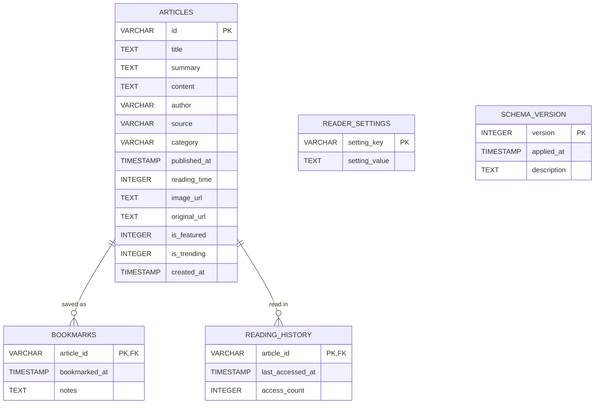

# NEWSROOM — Premium Editorial Desktop Reader (Phase 2)

[](https://openjdk.org/projects/jdk/21/)
[-blue.svg)]()
[-green.svg)]()
[]()
[-success.svg)]()

> **NEWSROOM** is a commercial-grade, native desktop news application engineered in Java using clean Object-Oriented Programming (OOP) principles, bespoke Swing component painting, embedded SQLite persistent storage, and real-time live news ingestion via syndication and REST APIs.

---

## 1. What's New in Phase 2

Phase 2 upgrades the Phase 1 editorial reader into a living, real-time, persistent desktop news application:

- **Real-Time News Ingestion:** Integrated live RSS syndication across 7 desks (BBC News, The Hindu, Ars Technica, CNBC, ScienceDaily, ESPN, Variety) with zero API keys required, plus support for NewsAPI.org when an API key is configured.
- **Embedded SQLite Persistence:** All articles, persistent bookmarks, reading history, and user settings are stored in local `newsroom.db` using SQLite JDBC with versioned schema migrations, foreign keys, and WAL mode.
- **Asynchronous Network Architecture:** Non-blocking HTTP client requests (`java.net.http.HttpClient`) with timeout controls and exponential backoff retries, ensuring the Swing Event Dispatch Thread (EDT) remains 100% fluid.
- **Asynchronous Image Loading with LRU Cache:** Real article photos are loaded in background threads and cached in memory with graceful fallback to our custom procedural editorial artwork.
- **Full Content Transparency & Original Browser Launch:**
  - Dedicated **"Open Original Article ↗"** action launching the desktop browser.
  - One-click **"Copy Link"** action to clipboard.
  - Transparent editorial notices when reading syndicated summaries.
- **Cache-First Offline Resilience:** Works seamlessly when offline, serving cached articles from SQLite with a visual offline status banner.
- **Credential Security:** Configurable via `newsroom.properties` or environment variables; API keys are never hardcoded, committed, or exposed in error logs.

---

## 2. Project Architecture & Package Structure

```
c:\Users\techg\Downloads\OOPS\
├── pom.xml                               # Maven project configuration (SQLite JDBC & SLF4J)
├── newsroom.properties.example           # Example configuration template for API keys & settings
├── .gitignore                            # Excludes credentials, databases, build outputs
├── manifest.txt                          # JAR manifest specifying Class-Path and Main-Class
├── build.bat                             # One-click Windows build script
├── run.bat                               # Windows launcher script
├── run.ps1                               # PowerShell launcher script
├── newsroom-2.0.0.jar                    # Standalone executable JAR with bundled dependencies
├── lib/                                  # SQLite JDBC & logging libraries
│   ├── sqlite-jdbc-3.45.2.0.jar
│   ├── slf4j-api-2.0.12.jar
│   └── slf4j-nop-2.0.12.jar
└── src/
    ├── main/java/com/newsroom/
    │   ├── NewsReaderApplication.java    # Application entry point (EDT lifecycle & AA configuration)
    │   │
    │   ├── config/                       # Secure Configuration (Encapsulation)
    │   │   └── AppConfig.java            # Reads newsroom.properties / env vars, masks secrets
    │   │
    │   ├── database/                     # Relational Database Management
    │   │   └── DatabaseManager.java      # SQLite connection manager, WAL mode, Schema Migrations
    │   │
    │   ├── repository/                   # Data Access Object (DAO) Layer
    │   │   ├── ArticleRepository.java    # Article CRUD, query, and search contracts
    │   │   ├── SqliteArticleRepository.java # Batch upsert, parameterized prepared statements
    │   │   ├── BookmarkRepository.java   # Persistent bookmark contracts
    │   │   ├── SqliteBookmarkRepository.java# Relational joins with articles
    │   │   ├── ReadingHistoryRepository.java# History tracking and deduplication contracts
    │   │   ├── SqliteReadingHistoryRepository.java# Recency-ordered access logs
    │   │   ├── SettingsRepository.java   # Key-value user settings contracts
    │   │   └── SqliteSettingsRepository.java# Persistent user preferences in SQLite
    │   │
    │   ├── network/                      # Network I/O & Caching
    │   │   ├── HttpClientManager.java    # java.net.http.HttpClient with timeouts & backoff retries
    │   │   └── AsyncImageLoader.java     # Asynchronous remote image loader with memory LRU cache
    │   │
    │   ├── parser/                       # Data Serialization & Sanitization
    │   │   ├── RssParser.java            # Secure XML parser (XXE prevention, HTML tag stripping)
    │   │   └── SimpleJsonParser.java     # Zero-dependency JSON parser for NewsAPI/GNews
    │   │
    │   ├── provider/                     # News Provider Strategy Layer
    │   │   ├── NewsProvider.java         # Strategy contract for pluggable news engines
    │   │   ├── RssNewsProvider.java      # Real-time RSS feeds (BBC, Hindu, Wired, CNBC, etc.)
    │   │   ├── NewsApiProvider.java      # NewsAPI.org REST client
    │   │   └── CompositeNewsProvider.java# Hybrid orchestrator with automatic fallback
    │   │
    │   ├── model/                        # Domain Models
    │   │   ├── Article.java              # Canonical URL, full-content transparency, Builder
    │   │   ├── Category.java             # Editorial desks enum with custom theme colors
    │   │   ├── HistoryEntry.java         # Reading history record with access counts & timestamps
    │   │   └── ReaderSettings.java       # User preferences (font size, dark mode, refresh rate)
    │   │
    │   ├── interfaces/                   # Contracts & Observers
    │   │   ├── Searchable.java           # Contract for keyword search matching
    │   │   ├── Bookmarkable.java         # Contract for bookmarked items
    │   │   ├── ThemeChangeListener.java  # Observer contract for theme transitions
    │   │   ├── BookmarkChangeListener.java # Observer contract for bookmark state changes
    │   │   ├── RefreshListener.java      # Observer contract for background refresh state
    │   │   ├── ArticleNavigationListener.java # Decoupled view navigation contract
    │   │   ├── NewsService.java          # High-level news repository contract
    │   │   ├── SearchService.java        # Search execution contract
    │   │   ├── BookmarkService.java      # Saved articles management contract
    │   │   └── ReadingHistoryService.java# Session history management contract
    │   │
    │   ├── service/                      # Business Logic Implementations
    │   │   ├── DatabaseNewsServiceImpl.java# SQLite cache, live sync, auto-refresh scheduling
    │   │   ├── DatabaseBookmarkServiceImpl.java# SQLite-backed persistent bookmarks
    │   │   ├── DatabaseHistoryServiceImpl.java# SQLite-backed deduplicated history stack
    │   │   └── DatabaseSearchServiceImpl.java# Hybrid search (SQLite archive + live network)
    │   │
    │   ├── data/
    │   │   └── SampleNewsDataProvider.java # 37 rich editorial articles for initial database seed
    │   │
    │   ├── theme/
    │   │   ├── AppTheme.java             # LIGHT and DARK theme definitions
    │   │   ├── ThemeColors.java          # Immutable palettes for light and dark modes
    │   │   └── ThemeManager.java         # Singleton theme controller with Observer notifications
    │   │
    │   ├── util/
    │   │   ├── DateTimeFormatterUtil.java# Relative time ("2h ago") and editorial dates
    │   │   └── UIUtils.java              # Antialiasing hints, font factories, color math
    │   │
    │   └── ui/                           # User Interface Layer (Swing + Custom Painting)
    │       ├── MainFrame.java            # Window coordinator, SQLite wiring, refresh coordinator
    │       ├── SidebarPanel.java         # 12-item navigation sidebar with active pills & badges
    │       ├── HeaderPanel.java          # Breadcrumbs, live search, date, refresh & offline badge
    │       ├── BaseViewPanel.java        # Abstract base class for all application screens
    │       ├── HomePanel.java            # Editorial homepage dashboard
    │       ├── CategoryPanel.java        # Desk-filtered article grids with sorting
    │       ├── ArticleDetailPanel.java   # Dedicated reading view with browser launch & copy link
    │       ├── SearchPanel.java          # Hybrid search interface with desk and sort filters
    │       ├── BookmarksPanel.java       # Persistent saved articles with empty states
    │       ├── HistoryPanel.java         # Chronological reading history with clear action
    │       ├── SettingsPanel.java        # Provider config, API key, SQLite maintenance, reset
    │       │
    │       └── components/               # Reusable UI Widgets
    │           ├── BaseArticleCard.java  # Abstract card base class (Template Method)
    │           ├── FeaturedArticleCard.java # Hero story banner card with prominent typography
    │           ├── GridArticleCard.java  # Responsive 2/3-column grid card
    │           ├── CompactArticleCard.java# Streamlined list item for headlines & search
    │           ├── TrendingArticleCard.java # Numbered rank card (01, 02...) for velocity
    │           ├── ArticlePlaceholderImage.java # Async remote image with procedural fallback
    │           ├── CategoryBadge.java    # Custom-painted category pill badge
    │           ├── EmptyStatePanel.java  # Clean empty state with icon, message, and action
    │           └── RoundedButton.java    # Antialiased button with hover feedback & styles
    │
    └── test/java/com/newsroom/
        ├── AcceptanceTest.java           # Phase 1 verification suite (9/9 passed)
        └── Phase2AcceptanceTest.java     # Phase 2 verification suite (10/10 passed)
```

---

## 3. SQLite Relational Database Architecture

The embedded SQLite database (`newsroom.db`) is automatically initialized and migrated using `DatabaseManager`:



### Key Database Features:
- **Write-Ahead Logging (WAL):** Enabled via `PRAGMA journal_mode = WAL;` allowing concurrent reader threads without locking writer threads.
- **Foreign Key Integrity:** `PRAGMA foreign_keys = ON;` with cascade deletion.
- **Parameterized SQL:** 100% of queries use `PreparedStatement` with zero string concatenation, eliminating SQL injection risks.
- **Batch Upsert:** Articles are ingested using `INSERT INTO articles ... ON CONFLICT(id) DO UPDATE SET ...`, updating existing stories without duplicating rows.
- **Performance Indexes:**
  - `idx_articles_cat_pub`: Accelerated category queries ordered by recency.
  - `idx_articles_pub`: Accelerated homepage chronological feeds.
  - `idx_articles_orig_url`: Instant deduplication by canonical source URL.
  - `idx_bookmarks_date`: Instant retrieval of saved articles in reverse chronological order.
  - `idx_history_date`: Fast access to recent session history.

---

## 4. Real-Time News Retrieval Strategy

The application employs a **Hybrid Composite Provider Architecture** (`CompositeNewsProvider`):

1. **Zero-Configuration Mode (Default - RSS):**
   - Out of the box, NEWSROOM streams live real-time reporting from curated RSS feeds:
     - **World:** BBC News World, NPR World
     - **India:** The Hindu National, Times of India
     - **Technology:** Ars Technica, TechCrunch, Wired
     - **Business:** CNBC Finance, Wall Street Journal Markets
     - **Science:** ScienceDaily, Phys.org
     - **Sports:** BBC Sport, ESPN
     - **Entertainment:** Variety, Hollywood Reporter
   - Requires **no registration, no keys, and has no rate-limit cutoffs**.
2. **API Mode (NewsAPI.org):**
   - When a user provides a NewsAPI.org developer key in `newsroom.properties` or through the Settings screen, the application switches to REST ingestion.
   - If rate limits (e.g. 100 requests/day free tier) or HTTP errors occur, the composite provider **seamlessly falls back to RSS feeds without interrupting the user**.
3. **Offline Mode:**
   - If network connectivity is lost, `DatabaseNewsServiceImpl` activates offline cache mode, serving stored reporting from SQLite and displaying an unobtrusive `Offline • Using Cache` badge in the header.

---

## 5. Security & Configuration Guide

### Optional Configuration (`newsroom.properties`)
Create a `newsroom.properties` file in the working directory (or copy from `newsroom.properties.example`):

```properties
# Provider Mode: COMPOSITE (Default), RSS, or NEWS_API
news.provider=COMPOSITE

# NewsAPI.org Developer Key (Optional):
news.api.key=your_api_key_here

# Country Filter (for NewsAPI):
news.country=us

# Auto-Refresh Interval in Minutes: 0 (Manual), 15, 30 (Default), 60
news.refresh.interval=30

# Local SQLite Database Path:
db.path=newsroom.db
```

### Environment Variable Alternative:
You can also supply your key via environment variable:
```bash
set NEWS_API_KEY=your_key_here
```

> **Security Guarantee:**
> - Secrets are never logged or echoed to the console.
> - The Settings UI masks keys (e.g., `sk_••••••••1234`).
> - The `.gitignore` excludes `newsroom.properties`, `*.db`, and log files from source control.

---

## 6. How to Run the Application

### Option A: Launch Pre-Built Executable JAR (Instant)
```bash
java -jar newsroom-2.0.0.jar
```

Or on Windows:
```cmd
run.bat
```
Or in PowerShell:
```powershell
.\run.ps1
```

### Option B: Build and Run from Source (Standard JDK 21)
```powershell
# 1. Compile source files with SQLite JDBC on classpath
$sources = Get-ChildItem -Recurse -Filter *.java src\main\java | Select-Object -ExpandProperty FullName
javac -cp "lib/*" -d bin -encoding UTF-8 $sources

# 2. Run application with subpixel antialiasing
java "-Dawt.useSystemAAFontSettings=on" "-Dswing.aatext=true" -cp "bin;lib/*" com.newsroom.NewsReaderApplication
```

### Option C: Build via Maven
```bash
mvn clean compile package
java -jar target/newsroom-desktop-2.0.0.jar
```

---

## 7. Automated Verification & Acceptance Tests

Execute the automated test suites to verify all Phase 1 and Phase 2 requirements:

### Run Phase 2 Test Suite (10 / 10 Tests):
```bash
java "-Djava.awt.headless=false" -cp "bin;lib/*" com.newsroom.Phase2AcceptanceTest
```

**Results:**
```
=================================================
 NEWSROOM PHASE 2 ACCEPTANCE TEST SUITE
=================================================
[TEST 1] SQLite Database Initialization & Schema V1 Migration ... PASSED
[TEST 2] SQLite Article Repository (CRUD & Upsert) ............. PASSED
[TEST 3] Bookmark Persistence Across Application Restarts ...... PASSED
[TEST 4] Reading History Persistence & Deduplication ........... PASSED
[TEST 5] Settings Persistence in SQLite ........................ PASSED
[TEST 6] RSS Feed Parser (XML Sanitization & Multi-Format) ..... PASSED
[TEST 7] Zero-Dependency NewsAPI JSON Parser ................... PASSED
[TEST 8] Provider Architecture (RSS, NewsAPI, Composite) ....... PASSED
[TEST 9] Offline Resilience & Cache-First Strategy ............. PASSED
[TEST 10] Swing MainFrame UI Lifecycle with Phase 2 Services ... PASSED
=================================================
PHASE 2 RESULTS: 10 / 10 TEST SUITES PASSED (100.0%)
=================================================
```

### Run Phase 1 Test Suite (9 / 9 Tests):
```bash
java "-Djava.awt.headless=false" -cp "bin;lib/*" com.newsroom.AcceptanceTest
```

**Results:**
```
=================================================
RESULTS: 9 / 9 TEST SUITES PASSED (100.0%)
=================================================
```

---

## 8. Summary of Completed Phase 2 Requirements

| Requirement | Implementation & Component |
| :--- | :--- |
| **Real News Retrieval** | Live RSS syndication across 7 desks (`RssNewsProvider`) + NewsAPI.org REST client (`NewsApiProvider`) via `CompositeNewsProvider`. |
| **SQLite Persistence** | Embedded SQLite with WAL mode, foreign keys, and versioned schema migrations (`DatabaseManager`). |
| **Persistent Bookmarks** | Bookmarks stored in `bookmarks` table, surviving application restarts (`SqliteBookmarkRepository`). |
| **Session & History Log** | Reading history deduplicated by article ID and ordered by recency (`SqliteReadingHistoryRepository`). |
| **Settings Persistence** | Font size, dark mode, provider preference, refresh interval saved in `reader_settings` table. |
| **Original Article Action** | "Open Original Article ↗" launches default browser; "Copy Link" copies URL to clipboard (`ArticleDetailPanel`). |
| **Content Transparency** | Editorial disclosure banner rendered when viewing syndicated summaries without full text. |
| **Asynchronous I/O** | Network requests executed on background threads; UI updated strictly on Swing EDT. |
| **Image Caching & Fallback** | Remote images loaded asynchronously into memory LRU cache (`AsyncImageLoader`), falling back to procedural covers. |
| **Offline Resilience** | Transparent cache-first fallback with `Offline • Using Cache` indicator badge in header. |
| **Security & Secrets** | Credentials loaded via `newsroom.properties` or environment variables; excluded via `.gitignore`; masked in UI. |
| **Preserved Phase 1 UI** | All original layouts, typography, color palettes, and navigation cards preserved and enhanced. |

---

## 9. Cloud Web Deployment (Render / Docker)

NEWSROOM v2.0 introduces dual-mode capability:
- **Desktop Swing Mode**: Runs locally as a native window application on Windows, macOS, or Linux.
- **Cloud Web Mode**: Automatically activates when deployed on Render or any cloud container platform listening on `$PORT`.

### Deploying to Render
1. In Render Dashboard, click **New +** &rarr; **Web Service**.
2. Connect your GitHub repository (`https://github.com/Manoj-2007-03/NEWS07.git`).
3. Select **Docker** as the Runtime (or let Render detect the root `Dockerfile` and `render.yaml`).
4. Click **Deploy Web Service**.
5. Once built, Render will issue a public live URL (e.g. `https://newsroom.onrender.com`).

### Testing Cloud Web Mode Locally
```bash
java -cp "bin;lib/*" com.newsroom.NewsReaderApplication --web
# Open http://localhost:8080 in your browser
```
